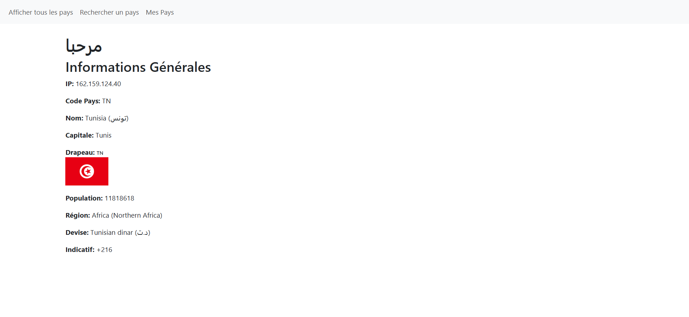

# 🌍 TpPayes — Application Angular d'Exploration des Pays

<p align="center">
  
</p>

<p align="center">
  <strong>Application Web moderne développée avec Angular 18 permettant d'explorer, de rechercher et d'analyser les pays du monde ainsi que la détection automatique par géolocalisation IP.</strong>
</p>

<p align="center">
  
  
  
  
  
</p>

---

## 📑 Sommaire

- [📌 À propos du projet](#-à-propos-du-projet)
- [✨ Fonctionnalités clés](#-fonctionnalités-clés)
- [📸 Aperçu & Captures d'écran](#-aperçu--captures-décran)
  - [1. Liste de tous les pays](#1-liste-de-tous-les-pays)
  - [2. Recherche de pays](#2-recherche-de-pays)
  - [3. Mon Pays & Géolocalisation IP](#3-mon-pays--géolocalisation-ip)
- [🛠️ Stack Technologique](#️-stack-technologique)
- [📂 Structure du Projet](#-structure-du-projet)
- [🔌 Services & Endpoints API](#-services--endpoints-api)
- [🚀 Installation & Démarrage](#-installation--démarrage)
- [👨‍💻 Auteur](#-auteur)

---

## 📌 À propos du projet

**TpPayes** est un projet académique conçu dans le cadre du cursus de **2ème Année** pour maîtriser les concepts fondamentaux et avancés du framework **Angular 18**.

L'application consomme l'API REST publique `countries.dev` pour récupérer les données géographiques et démographiques mondiales en temps réel, avec une interface utilisateur fluide, responsive et stylisée grâce à **Bootstrap 5**.

### Points forts :
- Architecture moderne en **Composants Standalone** (sans `NgModule` obsolète).
- Utilisation de la nouvelle syntaxe de contrôle de flux Angular (`@if`, `@for`).
- Communication HTTP asynchrone avec `HttpClient` et les Observables `RxJS`.
- Routage Angular dynamique (`RouterModule`, `routerLink`, `router-outlet`).
- Détection intelligente de la langue et message de bienvenue localisé.

---

## ✨ Fonctionnalités clés

1. **🌐 Afficher tous les pays (`/afficher`)** :
   - Récupération de la liste des pays depuis l'API.
   - Présentation tabulaire avec nom officiel, capitale, superficie, population et drapeau national.

2. **🔍 Recherche interactive de pays (`/rechercher`)** :
   - Saisie dynamique du nom d'un pays avec `FormsModule` (Two-way data binding `[(ngModel)]`).
   - Requête ciblée et affichage des métadonnées du pays correspondant.
   - Gestion élégante des erreurs (ex. message *"Pays non trouvé"* en cas de recherche invalide).

3. **📍 Mon Pays / Détection par adresse IP (`/monPayes`)** :
   - Détection automatique de la localisation réseau de l'utilisateur (`https://countries.dev/ip`).
   - Salutations multilingues dynamiques (*مرحبا*, *Salut*, *Hello*) selon la langue officielle détectée.
   - Détails complets : indicatif téléphonique, monnaie/devise, région, population, nom natif et drapeau.

---

## 📸 Aperçu & Captures d'écran

### 1. Liste de tous les pays
Affichage sous forme de tableau de l'ensemble des pays avec leurs données respectives.


---

### 2. Recherche de pays
Module de recherche textuelle avec affichage immédiat de la fiche pays.


---

### 3. Mon Pays & Géolocalisation IP
Détection automatique de l'IP du visiteur et affichage personnalisé des informations du pays d'origine.



---

## 🛠️ Stack Technologique

| Technologie | Version | Rôle |
| :--- | :---: | :--- |
| **Angular** | `18.2.0` | Framework Front-End principal (Standalone components) |
| **TypeScript** | `5.5.2` | Langage typé pour une maintenabilité optimale |
| **Bootstrap** | `5.3.8` | Framework CSS pour la mise en page et les composants UI |
| **RxJS** | `7.8.0` | Gestion de la programmation réactive et des flux asynchrones |
| **HTML5 / CSS3** | Standard | Structuration et habillage des vues |
| **API REST** | `countries.dev` | Fournisseur de données géographiques mondiales |

---

## 📂 Structure du Projet

```text
pays/
├── public/                     # Fichiers statiques publics
├── scrinshouts/                # Captures d'écran de l'application
│   ├── afficher tous.png
│   ├── monpayes.png
│   └── recehrch page.png
├── src/
│   ├── app/
│   │   ├── afficher/           # Composant d'affichage de tous les pays
│   │   │   ├── afficher.component.ts
│   │   │   ├── afficher.component.html
│   │   │   └── afficher.component.css
│   │   ├── rechercher/         # Composant de recherche de pays par nom
│   │   │   ├── rechercher.component.ts
│   │   │   ├── rechercher.component.html
│   │   │   └── rechercher.component.css
│   │   ├── mon-paye/           # Composant de détection IP & détails
│   │   │   ├── mon-paye.component.ts
│   │   │   ├── mon-paye.component.html
│   │   │   └── mon-paye.component.css
│   │   ├── app.component.ts    # Composant racine avec barre de navigation
│   │   ├── app.component.html
│   │   ├── app.routes.ts       # Définition des routes de l'application
│   │   └── app.config.ts       # Configuration globale (HTTP Client, Router)
│   ├── styles.css              # Styles globaux (Import Bootstrap)
│   └── main.ts                 # Point d'entrée de démarrage Angular
├── angular.json                # Configuration du workspace Angular CLI
├── package.json                # Dépendances et scripts npm
└── README.md                   # Documentation du projet
```

---

## 🔌 Services & Endpoints API

L'application consomme les endpoints suivants issus du service `countries.dev` :

| Méthode | Endpoint | Description |
| :---: | :--- | :--- |
| `GET` | `https://countries.dev/countries?fields=...` | Liste complète de tous les pays du monde |
| `GET` | `https://countries.dev/name/{nom}?fields=...` | Recherche d'un pays particulier par son nom |
| `GET` | `https://countries.dev/ip` | Récupération des infos du pays associé à l'IP du client |

---

## 🚀 Installation & Démarrage

Suivez ces étapes pour lancer le projet en local sur votre machine :

### Prérequis
- [Node.js](https://nodejs.org/) (version 18 ou supérieure recommandée)
- [npm](https://www.npmjs.com/) ou [yarn]
- [Angular CLI](https://angular.dev/tools/cli) installé globalement :
  ```bash
  npm install -g @angular/cli
  ```

### 1. Cloner le dépôt
```bash
git clone https://github.com/OussEmabouchahwa/TpPayes.git
cd TpPayes
```

### 2. Installer les dépendances
```bash
npm install
```

### 3. Lancer le serveur de développement
```bash
ng serve
```
Accédez ensuite à l'application dans votre navigateur à l'adresse : **`http://localhost:4200/`**.

### 4. Compiler pour la production
```bash
ng build
```
Les fichiers compilés prêts pour le déploiement seront générés dans le dossier `dist/`.

---

## 👨‍💻 Auteur

Développé par **Oussema Bouchahwa** :
- GitHub : [@OussEmabouchahwa](https://github.com/OussEmabouchahwa)
- Dépôt : [TpPayes](https://github.com/OussEmabouchahwa/TpPayes)

---

<p align="center">Projet Angular - Tous droits réservés &copy; 2026</p>
